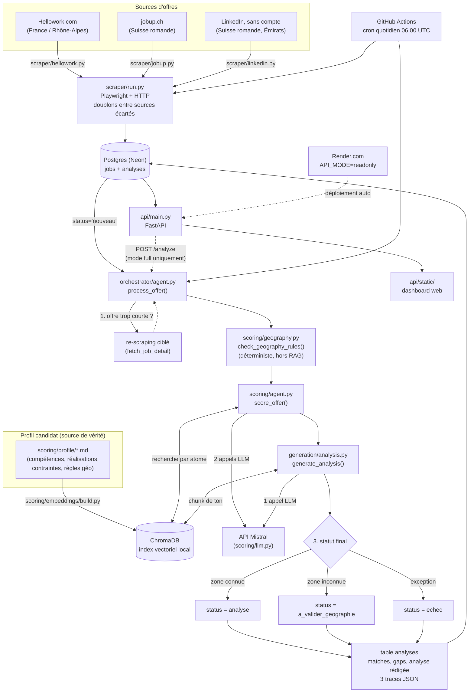

# Documentation technique — job-agent

> Documentation de référence, à jour au 2026-10-21 (session 20 : passage à Postgres). Complète `CLAUDE.md` (contexte
> métier et règles à ne jamais enfreindre) et `ROADMAP.md` (journal détaillé
> session par session, avec tous les tests réels effectués). Ce document a un
> objectif différent : donner une vue d'ensemble complète et compréhensible de ce
> qui existe, comment ça marche, et pourquoi c'est construit ainsi — pour
> quelqu'un qui reprend le projet à froid, y compris l'auteur lui-même dans six
> mois.

## Sommaire

1. [Objectif du projet](#1-objectif-du-projet)
2. [Vue d'ensemble de l'architecture](#2-vue-densemble-de-larchitecture)
3. [Stack technique](#3-stack-technique)
4. [Le pipeline, étape par étape](#4-le-pipeline-étape-par-étape)
5. [Module par module](#5-module-par-module)
6. [Règles métier critiques](#6-règles-métier-critiques)
7. [Déploiement](#7-déploiement)
8. [Automatisation (GitHub Actions)](#8-automatisation-github-actions)
9. [Tests](#9-tests)
10. [Décisions techniques et pourquoi](#10-décisions-techniques-et-pourquoi)
11. [Limites connues](#11-limites-connues)
12. [État actuel des données](#12-état-actuel-des-données)
13. [Commandes utiles](#13-commandes-utiles)
14. [Glossaire](#14-glossaire)

---

## 1. Objectif du projet

Agent de recherche d'emploi automatisé, avec un double objectif assumé dès le
départ (voir `CLAUDE.md`) :

1. **Outil fonctionnel** : scraper des offres réelles, les scorer par rapport à
   un profil candidat, générer une analyse de candidature honnête, sans jamais
   soumettre quoi que ce soit automatiquement — la validation humaine reste
   obligatoire avant toute action externe.
2. **Vecteur d'apprentissage** : chaque brique (RAG, agents LLM, orchestration,
   API, Docker, CI/CD) est un objectif pédagogique en soi, pas seulement un
   moyen. C'est pourquoi le projet évite délibérément les frameworks lourds
   (pas de LangChain) et implémente le RAG "à la main" avec une vraie
   indexation vectorielle plutôt qu'un simple prompt full-context.

Le profil ciblé est celui de l'utilisateur : Data Analyst/Scientist 3,5+ ans
d'expérience, cherchant en priorité la Suisse romande, puis les Émirats
Arabes Unis/Moyen-Orient, puis Lyon en repli pragmatique (voir §6).

## 2. Vue d'ensemble de l'architecture

Le projet est un pipeline linéaire en 4 étapes, orchestré par un cinquième
module qui prend de vraies décisions sur le déroulement (re-scraping,
statuts, gestion d'échec) plutôt que d'enchaîner les étapes sans condition.
Une API HTTP et un dashboard web exposent le résultat en lecture, et un
workflow GitHub Actions programme l'exécution quotidienne.



**Principe directeur** : chaque module a une responsabilité unique et ne
recalcule jamais ce qu'un module précédent a déjà décidé. Par exemple, la
génération d'analyse ne redétermine jamais la zone géographique — elle
consomme telle quelle celle produite par le scoring, qui lui-même ne la
recalcule jamais après l'avoir obtenue de `check_geography_rules`.

## 3. Stack technique

| Composant | Techno | Rôle | Statut pédagogique |
|---|---|---|---|
| Scraping | Playwright (sync API), `urllib` pour LinkedIn | Hellowork + jobup.ch + LinkedIn | déjà maîtrisé |
| Stockage offres | Postgres hébergé (Neon, tier gratuit), `psycopg` 3 | tables `jobs` + `analyses`, hors du dépôt git | nouveau (SQL déjà maîtrisé) |
| Indexation profil | ChromaDB (client persistant local) | RAG sur le profil candidat | **objectif d'apprentissage central** |
| Embeddings | `sentence-transformers` (`paraphrase-multilingual-mpnet-base-v2`), local | vectorisation, gratuit/offline | nouveau |
| LLM | API Mistral (`ministral-14b-latest`, surchargeable par `MISTRAL_MODEL`) | extraction d'exigences, scoring, génération | déjà maîtrisé (usage), nouveau (agentique) |
| Orchestration | boucle Python + dataclasses, pas de framework | décisions de pipeline | nouveau |
| API | FastAPI + uvicorn | HTTP sur l'orchestrateur | nouveau |
| Frontend | HTML/CSS/JS vanilla | dashboard de consultation | — (délibérément simple) |
| Packaging | Docker (`python:3.11-slim`) | déploiement reproductible | nouveau |
| CI/CD | GitHub Actions (cron + `workflow_dispatch`) | scraping/scoring quotidien | nouveau |
| Hébergement | Render.com (tier free) | dashboard public en lecture seule | nouveau |

Toutes les commandes du projet utilisent l'environnement virtuel dédié
`job-agent/.venv` (voir §10 pour pourquoi un venv séparé du reste de la
machine est nécessaire).

## 4. Le pipeline, étape par étape

Pour une offre donnée, du scraping à l'analyse finale :

1. **Scraping** (`scraper/`) — Playwright visite les pages de résultats de
   recherche puis chaque page de détail, extrait titre/entreprise/lieu/
   description/salaire/date, et insère en base via `upsert_job` (pas de
   doublon au re-scraping grâce à `UNIQUE(source, source_id)`) — si l'offre
   existe déjà, ses champs scrapés sont rafraîchis avec les valeurs de ce
   run, `status`/`user_verdict`/`scraped_at` restant intacts, voir §5.1).
   Pour jobup.ch, une offre republiée sous un nouvel identifiant est
   reconnue et rattachée à sa ligne existante au lieu d'être réinsérée
   (voir « Republications jobup » en §5.1). Une offre déjà stockée depuis
   une autre source n'est pas stockée une seconde fois (« Doublons entre
   sources », §5.1). LinkedIn (§5.1bis) passe par de simples requêtes HTTP.

2. **Indexation du profil** (`scoring/embeddings/`) — étape indépendante,
   relancée à chaque changement des fichiers `scoring/profile/*.md` : parse
   les fichiers en chunks (un chunk = une section `## chunk: nom`), les
   vectorise, reconstruit entièrement la collection ChromaDB, et recalcule
   la **baseline de bruit** (voir §5.3) utilisée pour distinguer un vrai
   match d'un bruit de fond.

3. **Orchestration** (`orchestrator/agent.py::process_offer`) — pour chaque
   offre au statut `nouveau` :
   - **Décision 1** : si le texte de l'offre (titre + description) fait
     moins de 300 caractères, tente un re-scraping ciblé de l'URL déjà en
     base avant de scorer (une offre trop courte n'a pas assez de matière
     pour un scoring fiable), avec le scraper de la source de l'offre,
     déduite du domaine de l'URL (avant la session 19, toujours celui de
     Hellowork, qui ne trouvait rien sur une page jobup).
   - La file `nouveau` est traitée par **priorité géographique** puis par
     ordre d'arrivée (`orchestrator/run.py::load_new_offers`), la zone étant
     calculée par les mêmes règles déterministes que le scoring.
   - **Scoring** (`scoring/agent.py::score_offer`, détaillé en §5.2).
   - **Décision 2** : si la zone géographique déterminée est `inconnu`, le
     pipeline continue quand même (scoring + génération), mais le statut
     final est `a_valider_geographie` plutôt que `analyse` — un humain doit
     vérifier manuellement plutôt que de faire confiance silencieusement à
     un ton par défaut.
   - **Génération** (`generation/analysis.py::generate_analysis`, §5.4).
   - **Décision 3** : toute exception (LLM, réseau, parsing) est capturée,
     tracée intégralement (stack trace complète), l'offre est marquée
     `echec`, et le batch continue avec l'offre suivante plutôt que de
     planter entièrement.

4. **Persistance des résultats** (`orchestrator/agent.py::process_offer`) —
   le statut final, l'analyse (matches/gaps/uncertain_flags fidèles au
   `ScoringResult`, markdown rédigé) et les trois traces (orchestrateur,
   scoring, génération) sont écrits dans la table `analyses`, dans la même
   transaction que le statut (§5.1). Jusqu'à la session 20, c'étaient des
   fichiers dans `orchestrator/runs/`, jamais sortis du runner de CI.

5. **Consultation** (`api/` + `api/static/`) — l'API FastAPI lit Postgres ;
   le dashboard affiche les offres, et le détail de l'analyse au seul
   propriétaire (jeton, §5.6).

## 5. Module par module

### 5.1 `storage/db.py` — schéma Postgres

Base Postgres hébergée chez Neon (tier gratuit, région Francfort) depuis la
session 20, chaîne de connexion dans `DATABASE_URL`. Deux tables :

```sql
CREATE TABLE jobs (
    id integer GENERATED BY DEFAULT AS IDENTITY PRIMARY KEY,
    source text NOT NULL,           -- 'hellowork' | 'jobup' | 'linkedin'
    source_id text NOT NULL,        -- id natif à la source
    url text NOT NULL,
    title text NOT NULL,
    company text, location text, contract_type text,
    salary text, experience text, description text,
    published_at text,              -- format brut, varie selon la source
    scraped_at timestamptz NOT NULL DEFAULT now(),  -- 1ère apparition, jamais réécrit
    last_seen_at timestamptz DEFAULT now(),         -- dernier scraping où l'offre est réapparue
    status text NOT NULL DEFAULT 'nouveau' CHECK (status IN (...)),
    user_verdict text CHECK (user_verdict IN (...)),  -- tri manuel dashboard, voir plus bas
    score integer, geography_zone text, sector text,  -- résumé public du scoring
    gaps_count integer, uncertain_count integer,
    UNIQUE (source, source_id)
);

CREATE TABLE analyses (            -- contenu personnel, servi au seul propriétaire
    job_id integer PRIMARY KEY REFERENCES jobs (id) ON DELETE CASCADE,
    matches jsonb, gaps jsonb, uncertain_flags jsonb,
    analysis_markdown text,
    orchestrator_trace jsonb, scoring_trace jsonb, generation_trace jsonb,
    updated_at timestamptz NOT NULL DEFAULT now()
);
```

La séparation suit la frontière public/privé : `jobs` contient ce que la
démo publique peut montrer (l'offre, le score, les compteurs), `analyses` ce
qui parle du candidat (points forts, écarts détaillés, analyse rédigée,
traces). `ON DELETE CASCADE` : supprimer une offre supprime son analyse.
L'orchestrateur écrit le statut final et l'analyse **dans la même
transaction** (`save_analysis`) : une offre au statut `analyse` a toujours
son analyse en base.

`status` prend 4 valeurs : `nouveau` (pas traité), `analyse` (succès),
`a_valider_geographie` (succès mais zone incertaine), `echec` (exception —
voir la trace orchestrateur pour le détail). La contrainte `UNIQUE(source,
source_id)` est scopée par source, donc deux offres de sources différentes
avec le même `source_id` numérique ne se percutent jamais.

`user_verdict` (`interessante` | `peut_etre` | `pas_interessante` | `NULL`)
est un jugement **manuel** de l'utilisateur, saisi depuis le dashboard (tri
façon swipe, §5.6) — jamais lu, calculé ni influencé par le pipeline de
scoring/génération, une donnée strictement humaine.

`last_seen_at`, contrairement à `scraped_at` (figé à la première apparition
pour toujours) et à `published_at` (date affichée par la source, qui peut
être republiée/rafraîchie sur une offre encore active — confirmé en direct
sur une offre Hellowork réelle dont la date affichée avait changé un mois
après le premier scraping), est **rafraîchi à chaque fois qu'une offre déjà
connue réapparaît dans un scraping** (`upsert_job`, §5.1 plus bas). C'est le
seul signal fiable de "cette offre est probablement encore active" —
utilisé par `storage/cleanup.py` pour décider quoi supprimer.

`init_db()` crée les tables si elles n'existent pas. Les migrations de
colonnes de l'époque SQLite ont disparu avec le passage à Postgres :
`storage/migrate_from_sqlite.py` a importé les 913 offres de l'ancien
`jobs.db` (identifiants conservés, horodatages convertis en UTC). 16 lignes
héritées n'ont pas de `last_seen_at` (colonne nullable pour elles) :
`storage/cleanup.py` ne les supprime jamais, décision laissée ouverte.

`connect()` ouvre une transaction courte : commit en sortie de bloc,
rollback sur exception. La base étant distante, le scraper n'en garde plus
une ouverte pendant toute la collecte : chaque étape (requête Hellowork, lot
jobup, LinkedIn) commite dès que ses offres sont stockées.

**`upsert_job`** ne fait plus un simple `INSERT OR IGNORE` (comportement
jusqu'à la session 14) : si l'offre existe déjà (`source`+`source_id`), ses
**champs scrapés** (`url`, `title`, `company`, `location`, `contract_type`,
`salary`, `experience`, `description`, `published_at`) sont rafraîchis avec
les valeurs de ce run, ainsi que `last_seen_at` — le scraper revisite déjà
la page de détail à chaque run, y compris pour les offres déjà connues
(voir `scraper/hellowork.py`/`jobup.py`), cette donnée fraîche n'était
auparavant tout simplement pas persistée. Correctif motivé par un cas réel
signalé par l'utilisateur : le tableau du dashboard affichait une date de
publication figée à la première visite, alors que l'offre était republiée
avec une date plus récente sur le site source (voir §8 pour le détail
complet). **`status`, `user_verdict` et `scraped_at` (première apparition)
ne sont en revanche jamais touchés** — ce sont des données propres à ce
projet (statut du pipeline, jugement humain, historique), pas des données
scrapées, un re-scraping ne doit jamais les écraser silencieusement.
Cette mise à jour vit dans `refresh_job(conn, job_id, job)`, qui réécrit
aussi `source_id`/`url` pour le cas suivant. Depuis la session 20,
`upsert_job` fait insertion ou rafraîchissement en une seule requête
(`INSERT … ON CONFLICT (source, source_id) DO UPDATE … RETURNING (xmax = 0)`,
`xmax = 0` signalant une ligne tout juste insérée) : un aller-retour réseau
au lieu de deux.

**Republications jobup (session 18).** jobup.ch attribue un **nouvel UUID
à chaque (re)publication** d'une offre, l'ancien répondant ensuite 404/410
(vérifié en direct sur les 61 lignes des 28 groupes de doublons trouvés en
base). Causes observées : flux ATS d'employeurs (SmartRecruiters pour
Talan/Nexthink) qui recréent l'annonce, agences d'intérim qui republient
tous les quelques jours (nouvelle date, parfois « (H/F) » ajouté au
titre), et doubles imports (deux UUID vivants pointant vers la même URL
ATS). Avec une clé `(source, source_id)` seule, chaque republication
devenait une nouvelle ligne `nouveau`, rescorée par Mistral : 38 lignes en
trop sur 185 offres jobup au 2026-09-26.

`scraper/jobup.py::is_same_offer(a, b)` décide si deux offres sont la même
annonce ; toutes les conditions doivent tenir, et toute preuve manquante
vaut « pas la même » :

| Critère | Pourquoi |
|---|---|
| Titre normalisé identique (accents, ponctuation et marqueurs `(H/F)`, `(h/f/x)`, `(m/w/d)` neutralisés — rien d'autre) | « Senior » vs « Principal Data and Applied Scientist » ont des descriptions similaires à 0,967 : seul le titre les distingue |
| Même lieu | |
| Même entreprise **si les deux sont connues** | Les lignes antérieures au correctif `9e5a3e6` ont « Offre pertinente ? » comme entreprise : traité comme inconnu |
| Descriptions présentes et similaires ≥ 0,85 (`difflib` sur les mots) | Mesuré : même annonce 0,889 à 1,0 (jobup régénère son résumé IA et sa traduction par UUID) ; autres postes du même employeur ≤ 0,79 ; deux vrais postes « Technicien qualité » à Neuchâtel (deux clients d'agence) : 0,20 |

`published_at` ne fait **pas** partie de la clé : il change sur la moitié
des republications réelles (ex. 14 → 22 septembre, description identique à
l'octet près).

`scraper/run.py::store_jobup_jobs` applique la règle au moment du stockage
— c'est là que le jumeau déjà en base (souvent déjà scoré) est visible —
en deux passes pour ne pas dépendre de l'ordre des résultats : d'abord les
`source_id` déjà connus (rafraîchis, marqués « vus ce run ») ; puis les
inconnus, comparés à toutes les lignes jobup. Sans correspondance → insertion.
Correspondance vue ce run → **alias** (l'annonce est vivante sous un autre
UUID déjà rafraîchi), rien n'est écrit. Correspondance non vue ce run →
**republication** : la ligne est re-pointée vers le nouvel UUID
(`refresh_job`), `status`, score et `user_verdict` conservés, donc aucun
nouvel appel Mistral. S'il existe plusieurs lignes correspondantes
(doublons antérieurs), celle qui porte un `user_verdict` est prioritaire,
puis la plus récemment vue. `run_jobup` collecte désormais toutes les
requêtes avant de stocker, pour que « vu ce run » couvre tout le run.

Les doublons stockés avant ce correctif se fusionnent avec
`python -m scraper.merge_jobup_duplicates` (même règle ; garde la ligne
avec verdict, sinon celle encore en ligne sur jobup, sinon la plus récemment
vue ; `--dry-run` pour lister sans supprimer).

**Doublons entre sources (session 19).** Sur la première collecte LinkedIn
(199 offres), 14 étaient déjà en base depuis jobup (FIA, Nexthink, Talan,
Vaudoise, Swissquote…). `is_same_offer` ne s'applique pas tel quel : les
lieux s'écrivent différemment (« Paudex » / « Paudex, Vaud, Switzerland »),
les noms d'entreprise aussi (« FIA – Fédération Internationale de
l'Automobile » / « FEDERATION INTERNATIONALE DE L'AUTOMOBILE »), et jobup
traduit en français les offres rédigées en anglais : la même offre Nexthink
ne ressemble plus qu'à 0,12 à son original LinkedIn, contre 0,86 à 0,96 pour
les jumeaux restés dans la même langue. `scraper/cross_source.py` exige donc
titre normalisé identique et même lieu (même ville, ou même zone ciblée),
puis :

| Cas | Décision |
|---|---|
| Entreprise connue des deux côtés | Même entreprise (égale ou contenue dans l'autre) → même offre, quelle que soit la langue. Décidable sur la carte de recherche, avant de charger la page de détail. |
| Entreprise inconnue d'un côté (lignes jobup avec l'artefact « Offre pertinente ? ») | Descriptions similaires ≥ 0,85 exigées. « Senior AI Engineer » Chaberton (LinkedIn) contre celui de Nexthink (jobup, entreprise inconnue) : 0,02 → séparés. |

Une offre reconnue n'est simplement **pas stockée** : la ligne existante
n'est pas touchée. La vérification s'applique à toute nouvelle offre, quelle
que soit la source (`_store_jobs`, `store_jobup_jobs`), donc aussi à une
offre jobup qui arrive après sa jumelle LinkedIn. Risque accepté : une même
entreprise qui publierait deux postes distincts au titre identique, au même
endroit, chacun sur un site différent.

### 5.1bis `scraper/linkedin.py` — LinkedIn sans compte

LinkedIn sert sa recherche d'offres aux visiteurs non connectés via deux
adresses qui renvoient des fragments HTML simples, lisibles sans navigateur
(`urllib` de la bibliothèque standard) :

- recherche : `jobs-guest/jobs/api/seeMoreJobPostings/search?keywords=…&location=…&f_TPR=r2592000&start=0,10…`
  (10 cartes par appel ; `location` en texte libre, résolu par LinkedIn) ;
- détail : `jobs-guest/jobs/api/jobPosting/<id>` (description, type de
  contrat, niveau, salaire quand l'employeur l'affiche).

Par défaut : « data scientist », « data analyst », « AI engineer » × Genève,
Vaud, Dubaï, Abu Dhabi, 2 pages chacune, offres des 30 derniers jours.
Rhône-Alpes reste le rôle de Hellowork (`--linkedin-location Lyon` pour
l'ajouter). Constats de la reconnaissance :

- `f_JT` (type de contrat) est **ignoré** sans connexion : les stages sont
  écartés côté code, d'abord sur le titre (sans requête), puis sur les
  critères « Employment type » / « Seniority level » de la page de détail ;
- les offres réservées aux ressortissants du Golfe (« UAE Nationals
  Only », « Emirati Talent ») sont écartées sur le titre ;
- les lieux sont en anglais (« United Arab Emirates » seul, « Geneva
  Metropolitan Area ») : `scoring/geography.py` a été complété, et passé en
  correspondance par mot entier (en sous-chaîne, « Suisse romande » tombait
  en Émirats via « oman », et « Crolles » en Suisse romande via « rolle »).

**Volume volontairement bas.** Les conditions d'utilisation de LinkedIn
interdisent la collecte automatisée ; le module ne reçoit jamais
d'identifiants (une session connectée automatisée est le moyen le plus sûr
de faire restreindre le compte de l'utilisateur). Pause de 2 à 4,5 s entre
deux requêtes, page de détail chargée **seulement pour les offres jamais
vues** (les autres sont marquées vues via `storage/db.py::mark_seen`), et le
premier refus (HTTP 429 ou 999) arrête LinkedIn pour la journée en gardant
ce qui a été collecté. `scraper/run.py` lance LinkedIn en dernier et isole
ses erreurs : les autres sources ne perdent rien si LinkedIn refuse l'IP du
runner GitHub.

### 5.2 `scoring/` — l'agent de scoring

Trois fichiers, trois responsabilités distinctes :

**`scoring/geography.py`** — classification géographique **déterministe**,
volontairement hors RAG. Le RAG sémantique s'était montré incapable de
distinguer fiablement Suisse romande et Suisse alémanique (une requête
piège "Zurich, environnement suisse-allemand" faisait remonter la règle
romande en premier). Le matching se fait par mots-clés de ville connue en
priorité, puis code département (Rhône-Alpes uniquement), puis abréviation
cantonale suisse (`VD`/`NE`/`GE`/`FR`/`VS`) en repli. Retourne un
`GeographyVerdict` (zone, rang de priorité, autorisation du signal de
mobilité, méthode de match utilisée) — voir `check_geography_rules_spec.md`
pour la spec formelle et `tests/test_geography.py` pour les 17 cas testés.

**`scoring/llm.py`** — client Mistral minimal, deux fonctions
(`call_llm`/`call_llm_json`). Gère un contournement d'un bug d'empaquetage
du wheel PyPI `mistralai` (import top-level cassé, fallback vers le chemin
interne `mistralai.client.sdk.Mistral`), et un retry à backoff exponentiel
(2s/4s/8s, 3 tentatives) ciblé strictement sur les erreurs HTTP 429 — toute
autre erreur (401, JSON malformé) remonte immédiatement sans retry inutile.

**`scoring/agent.py`** — la boucle de décision principale
(`score_offer`) :

1. Lit le seuil de bruit RAG dynamique (`get_noise_threshold()`, §5.3).
2. Appelle `check_geography_rules` — zone géographique déterminée avant
   tout appel RAG.
3. Si zone `inconnu` : `flag_uncertain("géographie")` sans bloquer la suite.
4. Recherche le chunk de règle de ton via le **nom de la zone**, jamais le
   texte brut de localisation de l'offre.
5. Demande au LLM d'extraire les exigences clés de l'offre (max 10, chacune
   avec un libellé composite d'affichage **et** ses éléments atomiques —
   voir encadré ci-dessous), et le **secteur d'activité** de l'offre/entreprise
   dans le même appel (zéro coût LLM additionnel — la description complète
   est déjà lue à cette étape). Le prompt propose une liste de secteurs
   courants (`SECTOR_SUGGESTIONS` : Énergie, Finance, Assurance, Secteur
   public, Agroalimentaire, Industrie, Santé, Conseil/ESN, Technologie/IT,
   Distribution/Retail, Transport/Logistique, Immobilier, Télécom, Média/
   Communication) pour limiter la fragmentation du filtre du dashboard,
   avec repli sur un libellé court proposé librement si aucun ne convient
   vraiment, ou `null` si le texte ne donne vraiment aucun indice.
6. Pour chaque exigence, recherche RAG **par atome individuel** (pas sur le
   libellé composite groupé), avec seuil de bruit appliqué atome par atome.
7. Arbitrage final par le LLM à partir de tout le contexte rassemblé
   (matches, gaps, seuils dépassés) → score 0-100, matches, gaps,
   résumé du raisonnement.

> **Pourquoi la recherche par atome et pas par phrase composite ?** Une
> phrase longue comme *"gouvernance et gestion des données QMS (ISO 13485,
> FDA 21 CFR Part 820, EU MDR)"* peut trouver un match RAG passable sur
> l'ensemble de la phrase même si aucune des normes citées individuellement
> n'a de vrai équivalent dans le profil — le bruit d'un élément se cache
> dans la longueur de la phrase. La recherche par atome applique le
> principe du **maillon faible** : un seul atome sans match fiable suffit à
> flaguer toute l'exigence incertaine, même si d'autres atomes de la même
> exigence ont bien matché. Un cas réel (offre 24, ISO 13485) a confirmé
> que cette granularité fine détecte un gap que la recherche composite
> manquait silencieusement.

Garde-fous appliqués à la sortie du LLM (`_validate_items`) : tout objet
hors du schéma strict attendu (`{"skill": ..., "matched_chunk_summary":
...}` pour un match, `{"skill": ..., "note": ...}` pour un gap) est
supprimé plutôt que gardé tel quel. Une compétence ne peut jamais
apparaître à la fois en `matches` et en `gaps` — en cas de contradiction,
le gap l'emporte (posture prudente, cohérente avec la règle d'honnêteté).

### 5.3 `scoring/embeddings/` — indexation et recherche vectorielle

**`parser.py`** — découpe chaque fichier `scoring/profile/*.md` sur les
headers `## chunk: nom`, extrait la ligne `Tags: ...`, produit un `Chunk`
avec un id `nom_fichier::nom_chunk`.

**`index.py`** — construit la collection ChromaDB (`build_index`) et
expose la recherche par similarité (`search_profile`/
`search_profile_with_scores`). Deux mécanismes clés :

- **Singletons thread-safe** pour le modèle d'embedding et le client
  ChromaDB (double-checked locking) — évite de repayer ~12s de vérification
  du cache HuggingFace Hub à chaque appel de `search_profile` (constaté :
  jusqu'à des dizaines d'appels par offre). Chargés explicitement au
  démarrage de l'API (`lifespan`), pas paresseusement au premier appel.
- **Seuil de bruit dynamique** (`get_noise_threshold`) : plutôt qu'une
  constante figée, `build_index` interroge la collection fraîchement
  construite avec 5 requêtes hors-sujet volontairement variées (cuisine,
  météo, sport, actualités, jardinage — `NOISE_PROBE_QUERIES`), calcule la
  **médiane** de leurs meilleures distances (médiane, pas moyenne, pour
  résister à un probe aberrant), et persiste cette baseline dans
  `chroma/noise_baseline.json`. Le seuil utilisé au scoring est
  `médiane × 0.85` (marge de sécurité empirique). Repli automatique sur
  l'ancien seuil fixe (0.75) si le fichier de baseline est absent/corrompu
  — jamais de crash pour un fichier de métadonnées manquant. Ce mécanisme
  s'adapte automatiquement si le profil grossit ou si le modèle
  d'embedding change, sans recalibration manuelle.

Modèle d'embedding : `paraphrase-multilingual-mpnet-base-v2` (remplace le
modèle par défaut de ChromaDB, `all-MiniLM-L6-v2`, jugé trop faible en
français et incapable de séparer nettement un vrai match du bruit sur du
texte RH bruité — voir ROADMAP session 2). Empiriquement, un vrai match
tombe autour de 0.33-0.65 de distance cosinus, le bruit autour de 0.75-0.85.

### 5.4 `generation/analysis.py` — génération de l'analyse markdown

`generate_analysis(result, offer_title, offer_description, company_name)`
transforme un `ScoringResult` en analyse markdown structurée à 4 sections
fixes : **Résumé du matching**, **Gaps et incertitudes**, **Questions
d'entretien probables**, **Angle de candidature**.

Points clés :
- Ne recalcule **jamais** la géographie — consomme `result.geography_zone`
  tel quel.
- Récupère le chunk de règle de ton via le même `ZONE_TO_QUERY` que le
  scoring, pour que scoring et génération s'accordent sur la même règle
  pour une même zone.
- `web_search(company_name)` : **stub désactivé**, décision assumée pour ne
  jamais fabriquer de contexte entreprise non vérifié (règle d'honnêteté du
  CLAUDE.md). Appelé et tracé quand l'offre est jugée trop courte/générique
  (< 300 caractères), retourne toujours `None`.
- Le prompt distingue explicitement un **gap confirmé** (compétence
  constatée absente) d'un **flag incertain** (aucun match RAG fiable, ce
  qui n'est pas la même chose qu'une absence confirmée) — cette nuance doit
  survivre jusqu'au texte généré, jamais diluée.
- **Interdiction stricte de toute mention de mobilité** (y compris en
  négation — "sans nécessité de mobilité" viole la règle autant que
  l'affirmer) quand la zone l'impose. Un bug réel a montré que le LLM
  pouvait nier la mobilité au lieu de simplement se taire dessus ; le
  prompt interdit désormais le mot et ses synonymes sous toute forme.
- **Sortie structurée sans second appel LLM** (`StructuredAnalysis`,
  correctif post-session 9) : `matches`/`gaps`/`uncertain_flags` sont
  reconstruits **en Python** directement depuis `ScoringResult`, pas
  re-extraits du markdown généré par un second appel LLM. Un LLM qui
  "réextrairait" la structure depuis sa propre sortie textuelle
  réintroduirait exactement le risque de divergence que cette approche
  élimine — zéro coût, zéro latence additionnelle, divergence
  structurellement impossible plutôt que simplement non observée.
  `StructuredAnalysis` porte aussi `sector` (copié tel quel depuis
  `ScoringResult.sector`, lui-même extrait par `scoring/agent.py`, §5.2) —
  persisté dans `structured_analysis_<id>.json` aux côtés des autres champs,
  lu par l'API via `.get("sector")` plutôt que `[...]` pour rester
  rétrocompatible avec les fichiers écrits avant l'ajout de ce champ.
  `scoring/backfill_sector.py` (script autonome, `python -m
  scoring.backfill_sector`) classe rétroactivement le secteur des offres
  déjà scorées sans relancer tout le pipeline (pas de RAG, pas de nouvel
  arbitrage géographique/scoring) : un seul appel LLM léger par offre,
  patché directement dans `structured_analysis_<id>.json` — idempotent,
  relançable après un échec de rate limit sans redemander aux offres déjà
  classées.

### 5.5 `orchestrator/` — la couche de décision de haut niveau

Voir §4 pour les 3 décisions. Point notable : `orchestrator/agent.py` ne
contient **aucun code qui envoie ou soumet quoi que ce soit à un système
externe** — il s'arrête après avoir produit le markdown et mis à jour le
statut en base (règle CLAUDE.md non négociable).

`orchestrator/run.py` est le point d'entrée CLI, avec un mode offre unique
(`--offer-id N`) et un mode batch (toutes les offres `nouveau`), plus un
délai configurable entre offres (`--delay-seconds`, défaut 2s) pour éviter
de saturer le rate limit Mistral en traitement par lot.

### 5.6 `api/` — l'API HTTP et le dashboard

**`api/main.py`** expose 6 endpoints, en pure exposition de ce que
l'orchestrateur produit déjà (aucune nouvelle logique métier) — à
l'exception de `POST /offers/{id}/verdict`, qui écrit un jugement humain,
jamais un résultat de pipeline :

| Endpoint | Rôle |
|---|---|
| `GET /health` | 3 vérifications sans appel réseau : clé Mistral présente, modèle d'embeddings chargé, base accessible. `200` si tout passe, `503` sinon. |
| `GET /offers` | Liste légère (statut, score, zone, secteur, dates, compteurs gaps/incertains, `user_verdict`, source, contrat, salaire, expérience, lien, `last_seen_at`) pour le dashboard. |
| `GET /offers/{id}` | Détail : description de l'offre, secteur, compteurs, `user_verdict`. Pour le propriétaire seulement : matches/gaps/uncertain_flags, markdown, 3 traces JSON. 404 seulement si l'`offer_id` n'existe pas. |
| `GET /owner` | `{"owner": true/false}` : le jeton envoyé est-il celui du propriétaire ? Utilisé par le dashboard avant de garder un jeton collé. |
| `POST /offers/{id}/verdict` | Propriétaire seulement (401 sinon). Enregistre (ou efface, `verdict: null`) le tri manuel. Simple écriture en base, disponible dans les deux `API_MODE`. |
| `POST /analyze` | Propriétaire seulement. Relance le pipeline complet sur une offre déjà en base. Synchrone (~30-90s), désactivé (503) en mode `readonly`. |

**Accès propriétaire (session 20)** — la base étant désormais partagée et
persistante, une écriture anonyme sur la démo publique modifierait les
vraies données. `OWNER_TOKEN` (variable d'environnement) est un secret que
le propriétaire colle une fois dans le dashboard ; il est ensuite envoyé en
`Authorization: Bearer <jeton>`. Comparaison en temps constant
(`secrets.compare_digest`), réponse propriétaire en
`Cache-Control: private, no-store`. Sans `OWNER_TOKEN` configuré côté
serveur, personne n'est propriétaire.

**Mode `API_MODE` (`full` | `readonly`)** — décision née d'une contrainte
réelle de déploiement (Render 512MB max) : en mode `readonly`, les imports
de `torch`/`chromadb`/`sentence-transformers` sont différés à l'intérieur
même des handlers (pas au niveau module), pour que le simple fait
d'importer `api.main` ne charge jamais ces bibliothèques en mémoire. Mesuré
concrètement : ~58MB RAM au repos en `readonly` contre ~750-920MB en
`full`. Utile pour comprendre pourquoi certains imports dans `api/main.py`
sont placés à l'intérieur des fonctions plutôt qu'en haut de fichier — ce
n'est pas un oubli, c'est la source réelle de l'économie mémoire.

**`api/static/`** (session 9, refondu en session 17) — dashboard en
HTML/CSS/JS vanilla, sans framework ni étape de build : des modules ES
natifs (`js/main.js` en point d'entrée) servis tels quels par `StaticFiles`.
Choix délibéré pour un outil personnel mono-utilisateur : rien à compiler,
rien à mettre à jour, et le déploiement reste « copier le dossier ».
`Cache-Control: no-cache` est ajouté sur `/static` (middleware dans
`api/main.py`) pour qu'un déploiement ne laisse pas un navigateur sur
l'ancienne version des modules.

Routage par hash (`#/`, `#/offres`, `#/trier`, `#/selection`,
`#/coulisses`), avec le détail d'une offre ouvert dans un tiroir adressable
(`#/offres?offre=4478`) — le bouton retour le ferme, et un lien vers une
offre précise peut être partagé.

| Fichier | Rôle |
|---|---|
| `js/api.js` | Appels `fetch` aux endpoints, avec le jeton propriétaire (gardé en `localStorage`) en `Authorization: Bearer`. |
| `js/store.js` | Liste des offres en mémoire, `setVerdict` optimiste (annulé si le serveur refuse), « nouveau depuis ta dernière visite », doublons probables, offres absentes des dernières collectes. |
| `js/format.js` | Libellés, dates (mêmes formats que `storage/db.py::parse_published_at`), nettoyage d'affichage (titres sans « H/F », entreprise manquante, bruit de l'encart IA de jobup dans les descriptions). |
| `js/charts.js` | Graphiques SVG faits main : arrivées par jour, distribution des scores, zones, secteurs, salaires, radar. |
| `js/drawer.js` | Tiroir de détail d'une offre. |
| `js/views/*.js` | Une vue par page. |

Les pages :

- **Brief** — ce qui a changé depuis la dernière visite (horodatage de la
  visite précédente gardé en `localStorage`), un radar des offres en
  attente (distance au centre = 100 − score), les meilleures offres
  encore à trier, et le marché en chiffres. Le score affiché est toujours
  le score brut du pipeline : les paliers 80/65/50 ne servent qu'à la
  lecture, rien n'est repondéré côté client.
- **Offres** — recherche plein texte (insensible aux accents), filtres
  (avis, zone, secteur, source, score minimum, nouveautés), tri,
  navigation clavier (`j`/`k`, `Entrée`, `1`/`2`/`3` pour donner un avis).
  Les doublons probables (même intitulé nettoyé, même lieu, même
  entreprise quand elle est connue) sont signalés `×n` et peuvent être
  repliés — signalés, jamais fusionnés : ce peut être deux postes réels.
- **Trier** — la pile de cartes façon swipe (Pointer Events : souris,
  tactile, stylet ; `←`/`↑`/`→`, `Z` pour annuler). Chaque carte montre un
  extrait de l'offre. Après une décision sur une offre qui a des doublons,
  un toast propose d'appliquer le même avis — jamais appliqué sans clic.
- **Sélection** — tableau par avis, glisser-déposer entre colonnes pour
  changer d'avis, export CSV (séparateur `;` et BOM pour Excel fr, avec
  des colonnes vides « Candidature envoyée le » / « Notes » pour suivre
  ses démarches) ou copie Markdown. Une alerte signale les offres gardées
  qui n'apparaissent plus dans les collectes depuis 3 jours (mesuré par
  rapport au dernier passage du scraper, pas à « maintenant ») : elles
  seront supprimées à 30 jours par `storage/cleanup.py`.
- **Coulisses** — le pipeline expliqué avec ses vrais chiffres, le rythme
  de collecte jour par jour (les pannes s'y voient comme des trous),
  l'état de `GET /health`, et les trois règles non négociables.

Transverses : palette de commandes (`Ctrl+K`), aide des raccourcis (`?`),
thème clair/sombre (suit le système, forçable), barre d'onglets en bas
d'écran sur mobile. Mode propriétaire (cadenas de l'en-tête, ou la palette) :
le jeton collé est vérifié par `GET /owner` avant d'être gardé, puis débloque
le tri et le détail de l'analyse (points forts, écarts, incertains). Sans
lui, seuls les compteurs sont visibles et le tiroir le dit.

## 6. Règles métier critiques

Ces règles viennent de `CLAUDE.md` et **conditionnent tout le pipeline** —
elles ne sont jamais réinventées ailleurs dans le code :

- **Priorités géographiques**, dans l'ordre : Suisse romande (1) → UAE/Golfe
  (3, priorité absolue en type de rôle mais rang 3 dans `ZONE_CONFIG` faute
  de source de scraping dédiée à ce jour) → Suisse alémanique/italienne (4)
  → Lyon/Rhône-Alpes (2 dans le code, repli pragmatique).
  Implémentées dans `scoring/geography.py::ZONE_CONFIG`.
- **Séparation stricte du signal de mobilité par géographie** :
  - Lyon/France : zéro mention, y compris en négation.
  - Suisse : mobilité personnelle mentionnable.
  - UAE/Moyen-Orient : ouverture à la relocalisation explicite et assumée.
  Implémentée dans `scoring/profile/geography_rules.md` (règles de ton) et
  appliquée par le prompt de `generation/analysis.py`.
- **Honnêteté non négociable** : jamais de fabrication ni d'exagération de
  compétence. Un gap doit être signalé explicitement plutôt que masqué. Le
  score doit refléter un jugement honnête, pas une optimisation cosmétique.
  Implémentée à plusieurs niveaux : `scoring/profile/skills.md` distingue
  explicitement "maîtrisé" de "notions seulement" ; `_validate_items`
  filtre les sorties LLM malformées ; le prompt de génération interdit
  explicitement d'inventer une compétence absente des matches fournis.
- **Jamais de soumission automatique de candidature** : aucun module du
  projet n'envoie quoi que ce soit à un système externe. Le pipeline
  s'arrête à la production de l'analyse markdown + statut en base ; la
  validation humaine est le seul chemin vers une action externe.

## 7. Déploiement

Deux chemins de déploiement distincts, pour deux usages différents :

**Docker local / self-hosted** (`docker/Dockerfile`,
`docker-compose.yml`) — mode `full` : image `python:3.11-slim`, PyTorch
CPU-only installé explicitement depuis l'index dédié PyTorch (sinon `pip`
résout par défaut la variante CUDA, ~9GB de bibliothèques NVIDIA inutiles
ici puisque l'inférence tourne sur CPU), dépendances verrouillées via
`docker/requirements-lock.txt` (un `pip freeze` figé de l'environnement
local qui a résolu le conflit `opentelemetry` entre `chromadb` et
`mistralai`, voir §10), Playwright/Chromium avec ses libs système Debian,
modèle `sentence-transformers` pré-téléchargé au build. Taille finale :
~6.6GB (poids incompressible du stack RAG local + Chromium). Les données
sont dans Postgres (`DATABASE_URL` du `.env`) ; un seul volume nommé
(`chroma`) garde l'index entre deux redémarrages, et
`docker/entrypoint.sh` le construit au premier démarrage si le volume est
neuf.

**Render.com** (`render.yaml`) — mode `readonly` : sert uniquement le
dashboard et les endpoints de lecture, en lisant Postgres en direct (les
verdicts du propriétaire y sont écrits aussi). Ne charge jamais le modèle
d'embeddings ni ChromaDB (~58MB RAM au repos, tient largement dans le tier
gratuit 512MB). Redéploiement automatique sur chaque push de code ; une
offre analysée par la CI apparaît sans redéploiement. Le tier `free`
Render met le service en veille après 15 min d'inactivité (cold start
~30-50s au réveil, propre à l'infrastructure Render).

## 8. Automatisation (GitHub Actions)

`.github/workflows/scrape-and-score.yml` — exécution Python directe (pas
Docker : un runner GitHub jetable n'a pas besoin de l'isolation que Docker
apporterait, et builder/puller ~6.6GB n'apporterait rien de spécifique
ici). Cron quotidien à 06:00 UTC (~08:00 Paris) + déclenchement manuel
(`workflow_dispatch`). Enchaîne : build de l'index ChromaDB (reconstruit à
chaque run depuis les fichiers source versionnés, jamais persisté
lui-même) → scraper (Hellowork + jobup.ch + LinkedIn, rafraîchit `last_seen_at` pour
toute offre déjà connue qu'il retrouve) → **suppression des offres
obsolètes** (`storage/cleanup.py`, voir ci-dessous) → orchestrateur batch
(`--max-minutes 50` : plus de nouvelle offre une fois le budget dépensé, la
file reprend au run suivant) → rattrapage des scores manquants. Chaque étape
écrit directement dans Postgres (secret `DATABASE_URL`) ; le workflow ne
commite plus rien.
LinkedIn fait partie du scraper par défaut depuis la session 19 ; s'il
refuse l'IP du runner, l'étape réussit quand même avec les deux autres
sources (voir §5.1bis).

**`storage/cleanup.py`** (`python -m storage.cleanup [--days 30]
[--dry-run]`) supprime toute offre dont `last_seen_at` dépasse le seuil
(30 jours par défaut), avec son analyse (cascade). Le
choix de `last_seen_at` plutôt que `published_at` (essayé en premier, puis
abandonné) est délibéré et vérifié en conditions réelles : `published_at`
est la date affichée par la source, que certains sites republient/
rafraîchissent sur une offre encore active (constaté directement — une
offre Hellowork scrapée le 13/07 affichait "Publiée le 12/08" un mois plus
tard) — elle ne reflète donc pas fiablement si une offre est toujours en
ligne. **Décision assumée : aucune protection pour les offres déjà triées**
(`user_verdict` non pris en compte) — une offre marquée "intéressante" est
supprimée comme n'importe quelle autre une fois le seuil dépassé.

**Persistance dans Postgres, plus par commit** (session 20) — de la session
8 à la 19, le bot committait `storage/jobs.db` après chaque étape. Simple,
mais : l'historique git grossissait d'un binaire de plusieurs Mo plusieurs
fois par jour, les verdicts posés sur la démo Render (écrits dans la copie
du conteneur) disparaissaient au redéploiement suivant, et les analyses
restaient sur le runner. Une base hébergée règle les trois ; chaque offre y
est écrite dès qu'elle est traitée, donc un run tué par un timeout ne perd
au pire que l'offre en cours.

`permissions: contents: read` : le workflow n'écrit plus dans le dépôt.

## 9. Tests

| Fichier | Couvre |
|---|---|
| `tests/test_geography.py` | `check_geography_rules` — 28 cas (11 de la spec, 6 ajoutés session 11 pour jobup.ch/Suisse romande, 11 en session 19 : correspondance par mot entier et formats de lieu LinkedIn) |
| `tests/test_generation.py` | Structure du markdown généré (4 sections, ordre), garde-fou anti-fabrication (chevauchement lexical entre `matched_chunk_summary` et le profil source), absence de vocabulaire de mobilité en zone France, fidélité `StructuredAnalysis` ↔ `ScoringResult` |
| `tests/test_llm_retry.py` | Mécanique du retry/backoff sur 429, en mock (4 cas déterministes : succès après 2 échecs, épuisement, 401 non retenté, timing exact du backoff) |
| `tests/test_llm_retry_live.py` | Preuve du retry contre un **vrai** rate limit Mistral (20 appels réels en rafale serrée) — pas un test à lancer en routine (consomme du vrai quota API) |
| `tests/test_jobup_parsing.py` | Extraction de l'entreprise des cartes jobup (`_card_company`) sur des textes de cartes réels |
| `tests/test_linkedin_parsing.py` | Cartes de recherche et pages de détail LinkedIn sur du HTML réel (`tests/fixtures/linkedin/`, scripts retirés) : id, URL canonique, entités HTML, contrat/niveau traduits, salaire, description structurée en lignes, filtres stage/ressortissants |
| `tests/test_cross_source.py` | Doublons entre sources (§5.1) sur les paires réelles de la première collecte LinkedIn (FIA, Talan, Nexthink traduit, piège Chaberton), comparaison des lieux, et 5 scénarios de stockage dans les deux sens sur un schéma Postgres jetable |
| `tests/test_jobup_dedup.py` | Republications jobup (§5.1) : normalisation des titres, `is_same_offer` sur des descriptions réelles (cas limite 0,891, Senior vs Principal, même intitulé mais autre poste), et 5 scénarios `store_jobup_jobs` sur un schéma Postgres jetable (re-pointage qui garde score/verdict, alias vivant, nouvelle offre vue deux fois, postes distincts, doublons antérieurs) |
| `tests/test_storage.py` | `storage/db.py` (upsert insertion/rafraîchissement, champs jamais écrasés, `mark_seen`, contrainte de statut, analyse remplacée puis supprimée en cascade), requête du nettoyage, import SQLite (ids, horodatages UTC, séquence, refus sans `--replace`) |
| `tests/test_api.py` | Les deux vues de l'API : public (compteurs, pas d'analyse) contre propriétaire (analyse, `no-store`), verdicts 401/200/422/404, `/analyze` 401 puis 503 en lecture seule, aucun propriétaire sans `OWNER_TOKEN` |

Les tests qui ont besoin d'une base créent chacun un schéma Postgres jetable
(`tests/db_fixture.py`) : sur `TEST_DATABASE_URL` si défini, sinon sur un
Postgres embarqué démarré par `pgserver` (`pip install pgserver`, sans
Docker). Ils ne touchent jamais aux tables du schéma public.

Pas de test des sélecteurs DOM de `scraper/` (testés
manuellement contre les sites réels à chaque session, documenté dans
`ROADMAP.md`) ni pour `orchestrator/agent.py` en isolation (testé de bout
en bout via des runs réels sur des offres synthétiques + réelles,
également documentés dans `ROADMAP.md`).

## 10. Décisions techniques et pourquoi

Sélection des décisions les plus susceptibles de surprendre quelqu'un qui
lit le code sans avoir lu tout `ROADMAP.md` :

- **Environnement virtuel dédié (`job-agent/.venv`)** : `chromadb` et
  `mistralai` ont des exigences `opentelemetry` mutuellement incompatibles.
  Un environnement Python global partagé avec d'autres projets casse
  l'import de l'un ou l'autre selon l'ordre d'installation. Toujours
  utiliser `job-agent/.venv/Scripts/python.exe`, jamais le Python global.
- **Fallback d'import `mistralai`** (`scoring/llm.py`) : le wheel PyPI
  `mistralai==2.6.0` n'expose pas `Mistral` depuis le package racine — bug
  d'empaquetage upstream, pas un problème d'environnement. Contourné par un
  `try/except` vers `mistralai.client.sdk.Mistral`.
  Le même fallback fonctionne identiquement en conteneur Docker.
- **Géographie hors RAG** : la similarité sémantique ne peut pas fiablement
  distinguer "Genève" de "Zurich" (les deux sont "la Suisse" pour un
  embedding) — remplacé par du matching déterministe par mots-clés/codes
  postaux, plus lent à écrire mais prévisible et testable exhaustivement.
- **Granularité atomique du matching RAG** (§5.2) : chercher sur le
  libellé composite d'une exigence peut masquer l'absence de match sur un
  de ses éléments constitutifs. La recherche par atome individuel, avec la
  règle du maillon faible, est plus coûteuse en appels RAG (locaux, donc
  gratuits) mais détecte des gaps que l'ancienne approche manquait
  silencieusement.
- **Seuil de bruit RAG dynamique, pas une constante** (§5.3) : recalculé à
  chaque build d'index depuis 5 requêtes hors-sujet, avec repli sur
  l'ancien seuil fixe (0.75) si la baseline est indisponible. S'adapte
  automatiquement à la taille du profil et au modèle d'embedding, plutôt
  que de devoir être recalibré manuellement à chaque changement.
- **Singletons pour le modèle d'embeddings** : la première construction de
  `SentenceTransformerEmbeddingFunction` dans un process paie ~12s de
  vérification HTTP du cache HuggingFace Hub. Un singleton thread-safe
  garantit que ce coût n'est payé qu'une fois par process, pas à chaque
  recherche RAG (dizaines par offre).
- **`API_MODE=readonly`** : la vraie source d'économie mémoire n'est pas un
  blocage de façade sur l'endpoint, mais l'endroit où l'import Python a
  lieu — `torch` se charge en mémoire dès l'import du module, avant toute
  instanciation. Les imports lourds sont donc différés à l'intérieur des
  handlers, exécutés seulement hors mode `readonly`.
- **Zéro appel LLM pour la sortie structurée** (`StructuredAnalysis`,
  §5.4) : l'information existait déjà dans `ScoringResult` — la construire
  en Python plutôt que de la re-extraire du markdown via un second appel
  LLM élimine structurellement le risque de divergence entre le score
  affiché et le texte généré.
- **Docker : PyTorch CPU-only installé séparément** : un `pip install`
  naïf du même pin de version résout par défaut la variante CUDA dans
  l'image Debian slim, même si l'environnement local avait résolu la
  variante CPU — ~9GB de bibliothèques NVIDIA inutiles pour un projet qui
  n'utilise jamais le GPU. Installé explicitement depuis l'index CPU-only
  officiel de PyTorch pour lever l'ambiguïté.
- **Dédoublonnage jobup au stockage, pas avant le fetch des détails**
  (§5.1) : la page de résultats donne titre/entreprise/lieu/date, mais pas
  de quoi distinguer une republication d'un second vrai poste au même
  intitulé — seule la description le permet (0,20 contre ≥ 0,889 sur les
  cas réels). Et la plupart des jumeaux sont en base depuis un run
  précédent, pas dans le même run. Le coût évité est l'appel Mistral, pas
  le chargement de la page de détail (déjà refait à chaque run pour
  rafraîchir les offres connues).
- **Postgres hébergé plutôt que SQLite commité** (§8, session 20) : même
  langage SQL, mais une base que la CI, l'API déployée et le poste local
  lisent et écrivent tous en direct. Neon parce que son tier gratuit suffit
  (0,5 Go), qu'il se met en veille sans perdre les données et se réveille
  en environ une seconde. `timestamptz` plutôt que du texte pour les dates,
  `jsonb` pour les listes de l'analyse, contraintes `CHECK` sur les statuts.
- **Accès propriétaire par jeton** (§5.6) : un seul utilisateur, donc pas de
  comptes ni de mots de passe — un secret partagé entre le serveur et un
  navigateur suffit, et il ne protège que les écritures et le contenu
  personnel ; le reste de la démo reste public.

## 11. Limites connues

Non exhaustif — voir `ROADMAP.md` pour le détail complet de chaque
limite, avec son contexte de découverte :

- LinkedIn (§5.1bis) repose sur des adresses publiques non documentées,
  que LinkedIn peut modifier ou fermer, et ses conditions d'utilisation
  interdisent la collecte automatisée : volume volontairement bas, jamais
  de compte. Les plages d'IP des runners GitHub sont souvent refusées : la
  collecte LinkedIn peut n'aboutir qu'en local.
- Doublons entre sources (§5.1) : tant qu'une ligne jobup porte encore
  l'artefact « Offre pertinente ? », une offre traduite par jobup n'est pas
  reconnue (l'entreprise manque et les descriptions diffèrent par la
  langue) et reste stockée deux fois.
- `POST /analyze` est synchrone (bloque ~30-90s), pas de file de tâches en
  arrière-plan — acceptable pour un usage personnel mono-utilisateur,
  deviendrait un problème sous charge concurrente.
- Le garde-fou anti-fabrication des tests (`tests/test_generation.py`) est
  un contrôle de cohérence lexicale basique (chevauchement de mots-clés),
  pas une vérification sémantique — ne détecterait pas une justification
  qui réutilise des mots du profil dans un sens détourné.
- Le score et les matches/gaps dépendent entièrement du jugement du LLM
  sur la pertinence sémantique des chunks retrouvés — pas de garde-fou
  supplémentaire équivalent à la séparation géographique déterministe.
- Image Docker à ~6.6GB — poids jugé incompressible pour ce stack
  (sentence-transformers + Chromium + torch CPU) sans tentative de build
  multi-stage à ce jour.
- `docker/requirements-lock.txt` est un `pip freeze` figé manuellement, pas
  de mécanisme automatique de synchronisation avec `requirements.txt`.
- Dédoublonnage jobup (§5.1) : le seuil 0,85 est calibré sur 31 groupes
  réels, pas sur un corpus étiqueté. Volontairement prudent : une
  republication dont le titre change au-delà des marqueurs de genre (ex.
  « Ingénieur Développeur logiciel » → « … (machines) », descriptions à
  0,996) reste une ligne distincte, et donc un scoring de plus.
- Le score d'une même annonce varie d'un scoring à l'autre : sur les
  doublons jobup scorés séparément, jusqu'à 23 points d'écart pour un texte
  quasi identique (« Développeur .Net API » : 45 et 68). C'est un bruit
  propre au LLM, que le dédoublonnage rend moins visible mais ne corrige
  pas.

## 12. État actuel des données

Au 2026-10-21, la base contient **913 offres** (909 `analyse`, 4 `echec`) :
409 de LinkedIn, 322 de jobup.ch, 182 de Hellowork. Les analyses détaillées
ne sont conservées que depuis la session 20 : celles produites avant par la
CI n'ont jamais quitté le runner, il n'en reste que les compteurs.

## 13. Commandes utiles

Toujours depuis `job-agent/`, avec l'environnement virtuel dédié.

```bash
# Scraper (les trois sources par défaut ; --source both = Hellowork + jobup)
.venv/Scripts/python.exe -m scraper.run

# LinkedIn seul, en ajoutant Lyon aux lieux
.venv/Scripts/python.exe -m scraper.run --source linkedin --linkedin-location Genève --linkedin-location Lyon

# Scraper une seule source, avec une requête personnalisée
.venv/Scripts/python.exe -m scraper.run --source jobup --query "data engineer" --pages 2

# Reconstruire l'index ChromaDB (après modification de scoring/profile/*.md)
.venv/Scripts/python.exe -m scoring.embeddings.build

# Scorer + générer l'analyse d'une seule offre
.venv/Scripts/python.exe -m orchestrator.run --offer-id 7

# Traiter toutes les offres au statut 'nouveau'
.venv/Scripts/python.exe -m orchestrator.run --delay-seconds 2

# Fusionner les offres jobup stockées sous plusieurs identifiants (§5.1)
.venv/Scripts/python.exe -m scraper.merge_jobup_duplicates --dry-run

# Lancer l'API + dashboard en local
.venv/Scripts/python.exe -m uvicorn api.main:app --reload
# puis ouvrir http://127.0.0.1:8000

# Importer l'ancien jobs.db dans une base Postgres vide (une seule fois, §5.1)
.venv/Scripts/python.exe -m storage.migrate_from_sqlite jobs-latest.db --dry-run

# Lancer les tests hors ligne (Postgres jetable : pgserver ou TEST_DATABASE_URL)
for t in storage api jobup_dedup cross_source geography jobup_parsing linkedin_parsing llm_retry; do .venv/Scripts/python.exe tests/test_$t.py; done

# Docker (mode full, local)
docker compose up -d
```

## 14. Glossaire

- **Chunk** — unité de découpage du profil candidat, une section
  `## chunk: nom` dans `scoring/profile/*.md`, indexée individuellement
  dans ChromaDB.
- **Zone géographique** — une des 6 valeurs produites par
  `check_geography_rules` : `suisse_romande`, `rhone_alpes`, `uae_gcc`,
  `suisse_autre`, `autre_france`, `inconnu`.
- **Flag incertain (`uncertain_flag`)** — signal produit quand aucun match
  RAG fiable n'a été trouvé pour une exigence, distinct d'un **gap**
  (compétence constatée absente). Un flag incertain ne veut pas dire
  "compétence absente", mais "pas de preuve trouvée".
- **Trace** — journal structuré (JSON) de chaque décision prise par un
  agent (géographie, requêtes RAG avec distances, flags), produit à 3
  niveaux (orchestrateur, scoring, génération) pour un audit complet a
  posteriori.
- **Seuil de bruit (`noise_threshold`)** — distance cosinus au-delà de
  laquelle un résultat RAG est considéré comme non pertinent, calculée
  dynamiquement (§5.3).
- **Atome** — élément technique individuel constitutif d'une exigence
  composite extraite par le LLM (ex. "ISO 13485" est un atome de la
  compétence composite "gouvernance QMS (...)").
